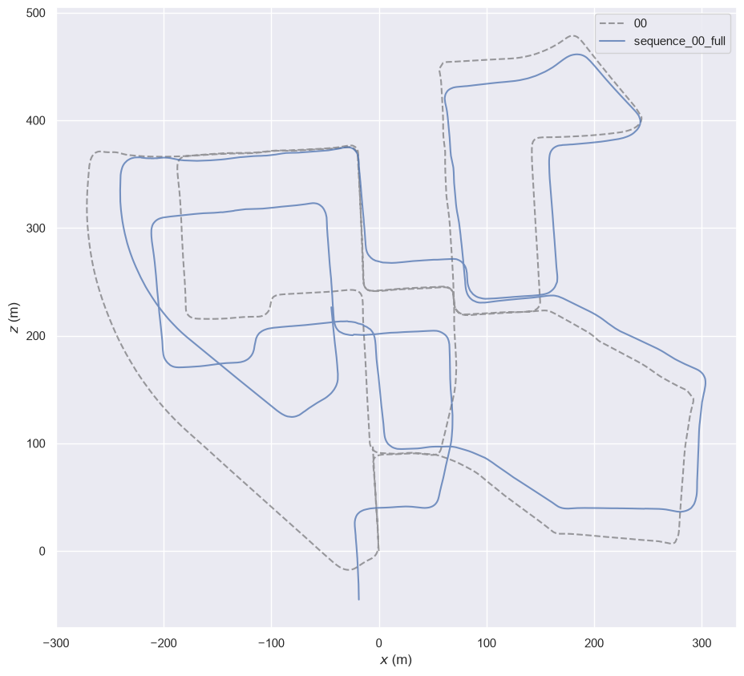
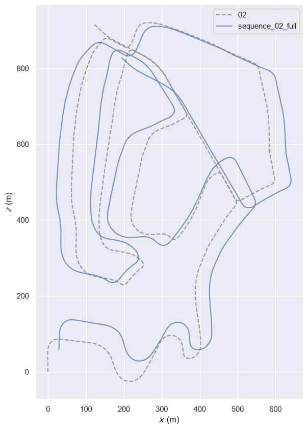
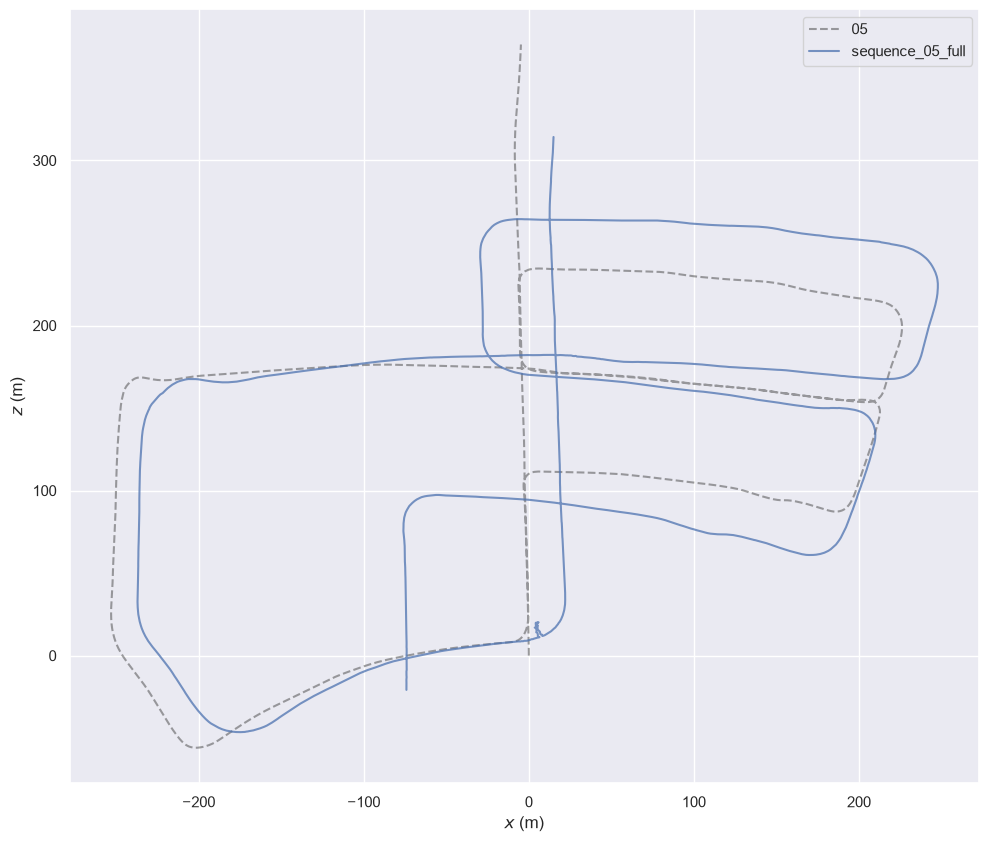

# Baseline VO Evaluation — KITTI

**Date:** November 23, 2026
**Dataset:** KITTI Odometry (sequences 00, 02, 05)

## 1. Evaluation Setup

The baseline monocular visual odometry pipeline uses:

- FAST feature detection
- Pyramidal Lucas–Kanade (KLT) tracking
- OpenCV `findEssentialMat()` with RANSAC
- OpenCV `recoverPose()` for relative pose estimation
- Sequential pose accumulation

The experiments were performed on the complete image sequences.

| Parameter | Value |
|---|---:|
| FAST threshold | 20 |
| RANSAC confidence | 0.999 |
| RANSAC threshold | 1.0 px |
| Minimum inliers | 8 |
| Maximum frames | Unlimited |

## 2. Results

| Metric | KITTI 00 | KITTI 02 | KITTI 05 |
|---|---:|---:|---:|
| Frames | 4541 | 4661 | 2761 |
| Successful pose estimates | 4513 | 4660 | 2712 |
| Skipped estimates | 27 | 0 | 48 |
| Success rate (%) | 99.41 | 100.00 | 98.26 |
| ATE RMSE (m) | 52.0466 | 48.9736 | 34.1492 |
| Translational RPE RMSE (m) | 0.2760 | 0.2380 | 0.2787 |
| Rotational RPE RMSE (deg) | 0.1429 | 0.1170 | 0.1016 |

## 3. Evaluation Protocol

Evaluation was performed using **evo 1.38.1**.

- ATE: Translation component, with global Sim(3) Umeyama alignment.
- Translational RPE: Consecutive frame pairs (`delta = 1`), with global scale correction.
- Rotational RPE: Rotation angle in degrees, for consecutive frame pairs (`delta = 1`).

The reported scale corrections are global. Per-frame translation scaling using consecutive ground-truth baseline lengths, as described in the project methodology, has not yet been evaluated.

## 4. Trajectory Plots

### KITTI 00

### KITTI 02

### KITTI 05

## 5. Conclusion

The baseline pipeline successfully estimated relative camera motion across all three sequences, with success rates above 98%.

Rotational RPE remained relatively low, while ATE indicated substantial accumulated trajectory error. This is consistent with the scale ambiguity of monocular translation estimation and the limitations of sequential pose accumulation.

These results will serve as the reference for evaluating the custom five-point solver and subsequent improvements.